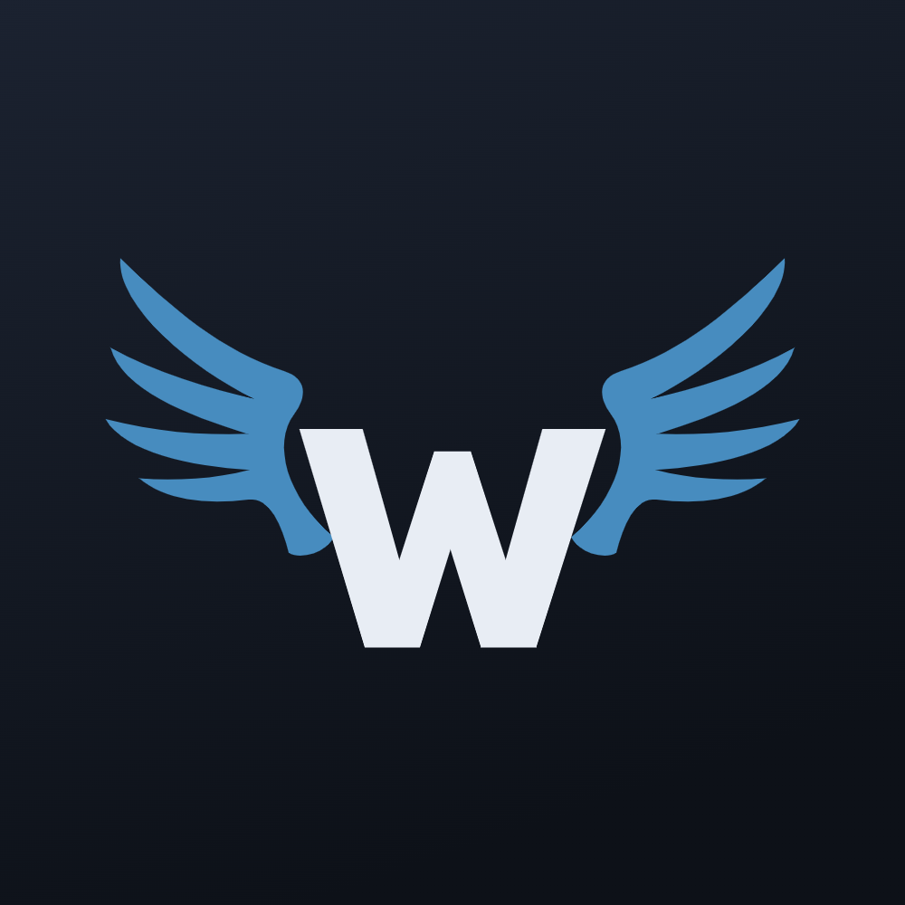
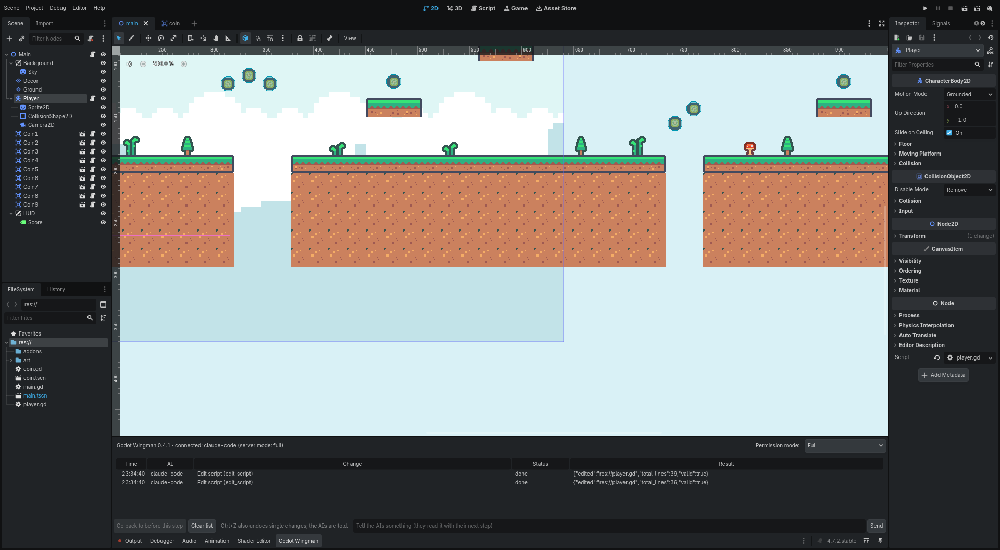

  

<h1 align="center">Godot Wingman</h1>

  <b>Let your AI app use the Godot editor.</b> 
  It builds scenes, writes scripts, plays the game with real input, reads the errors and fixes them.

  <a href="https://godot-wingman.pages.dev"><b>Website</b></a> ·
  <a href="https://github.com/Godot-Wingman/godot-wingman"><b>Source</b></a> ·
  <a href="https://github.com/Godot-Wingman/godot-wingman#quick-start"><b>Quick start</b></a> ·
  <a href="https://github.com/Godot-Wingman/godot-wingman/releases"><b>Releases</b></a>

  

### What it is

A local [MCP](https://modelcontextprotocol.io) server and a Godot addon. Your AI app (Claude Code, Claude Desktop, Codex, Cursor, Gemini CLI, Windsurf, GitHub Copilot in VS Code and other MCP clients) gets 121 tools to work in the open Godot editor, with undo, and to run and play the game.

- **Free and open source** under the AGPL-3.0. Games you make with it are yours, under any license.
- **Runs on your computer.** No accounts, no cloud, no telemetry.
- **Godot 4.5 or newer**, GDScript and C#.
- **One command to install** on Windows, macOS and Linux.

### Repositories

| Repository | What is in it |
|---|---|
| [godot-wingman](https://github.com/Godot-Wingman/godot-wingman) | The MCP server, the Godot addon, the installers and the docs |
| [godot-wingman-landing](https://github.com/Godot-Wingman/godot-wingman-landing) | The website at godot-wingman.pages.dev |

Godot Wingman is a community project. It is not made by, affiliated with or endorsed by the Godot Foundation or the Godot Engine project. "Godot" is a trademark of the Godot Foundation.
